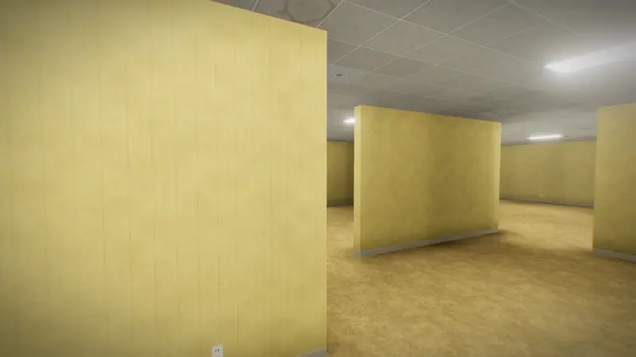
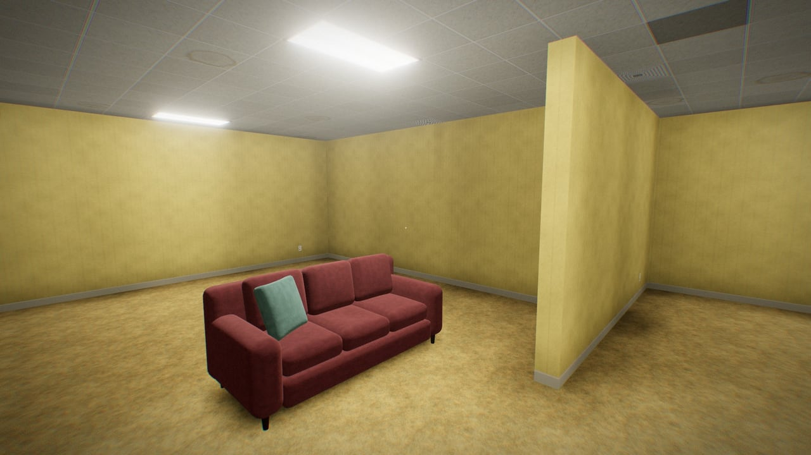
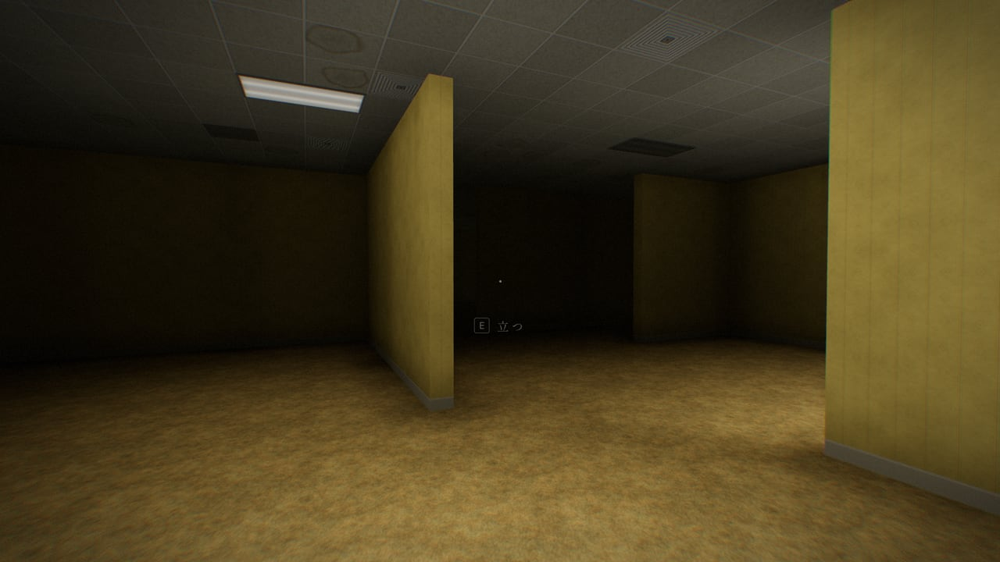
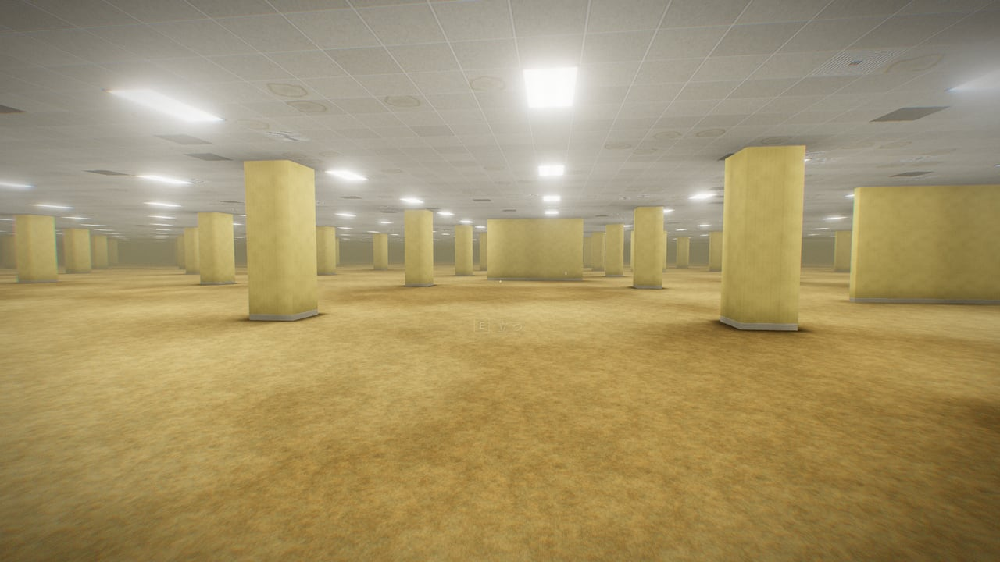
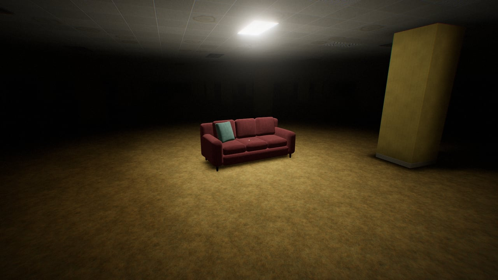
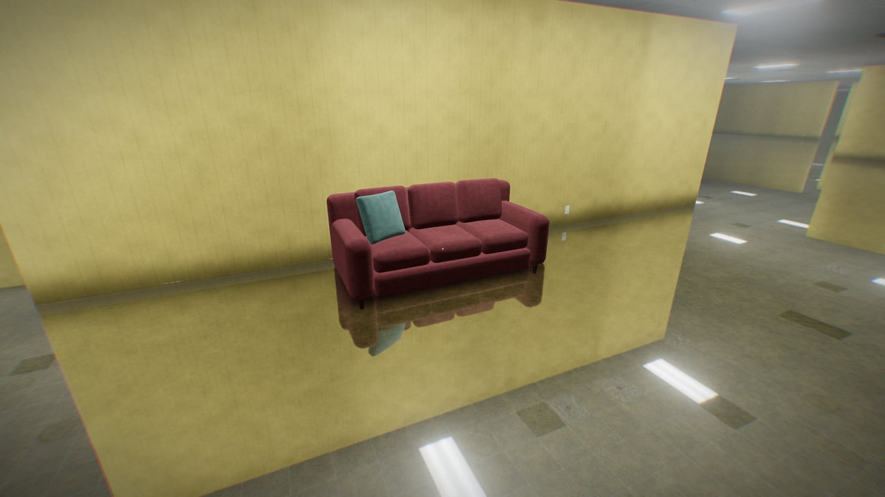
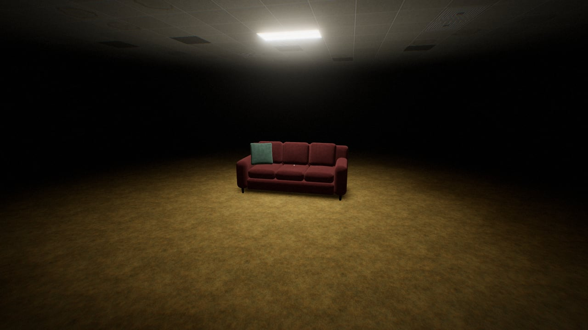

# ソファーがある。 — There Is a Sofa.

黄色い部屋がどこまでも続く場所に、ソファーがぽつんとある。ブラウザで歩くインタラクティブ作品です。

[](https://tanuu5.github.io/sofa-ga-aru/)
[](https://www.anthropic.com/claude)
[](./LICENSE)
[](#english)

<p align="center">
  
</p>

<p align="center"><b><a href="https://tanuu5.github.io/sofa-ga-aru/">▶ ブラウザで遊ぶ：https://tanuu5.github.io/sofa-ga-aru/</a></b><br>インストール不要・約 10 分・キーボードとマウス／ゲームパッドに対応</p>

**Claude Code × Claude Opus 5.5（MAX）** で作りました。

黄色い壁紙と湿ったカーペットの部屋が、どこまでも続いています。蛍光灯がうなり、ときどきちらつきます。どこかに、ソファーがひとつだけあります。座ると、何かが起きます。

画像・音声ファイルは使っていません。壁紙やカーペットの模様、ソファーの形から、蛍光灯のうなり、足音、遠くで鳴る音楽まで、すべてコードで生成しています。

日本語と英語に対応しています（ブラウザの言語で切り替わります。URL に `?lang=en` / `?lang=ja` を付けても切り替えられます）。English follows below.

## スクリーンショット

<table>
  <tr>
    <td width="50%"><br><sub>角を曲がると、ソファーがぽつんとある。</sub></td>
    <td width="50%"><br><sub>座ると、遠くの明かりから順に消えていく。</sub></td>
  </tr>
  <tr>
    <td width="50%"><br><sub>目を覚ますと、壁のない柱の広間。</sub></td>
    <td width="50%"><br><sub>明かりが落ち、遠くにひとつだけ残る。</sub></td>
  </tr>
  <tr>
    <td width="50%"><br><sub>水びたしの部屋。どこかで鳴る音楽をたどる。</sub></td>
    <td width="50%"><br><sub>明かりがひとつだけの暗闇。</sub></td>
  </tr>
</table>

画像と動画は、すべて実際の画面です。

## 遊び方

何をすればいいかは書きません。歩いて、見つけて、座ってみてください。通しで 10 分ほどです。ヘッドホンをおすすめします。

| 操作 | キーボード・マウス | ゲームパッド | タッチ |
| --- | --- | --- | --- |
| 歩く | `W` `A` `S` `D` / 矢印キー | 左スティック | 画面の左側をなぞる |
| 見回す | マウス | 右スティック | 画面の右側をなぞる |
| 座る・立つ | `E` / クリック / `Space` | 下のボタン（✕ / A） | 「座る」「立つ」ボタン |
| 立つ | — | 右のボタン（○ / B）でも | — |
| 走る | `Shift` | L2・R2 を押している間 / L3 で切り替え | — |
| 一時停止 | `Esc` | OPTIONS / ≡ ボタン | 右上の Ⅱ |

- 一時停止メニューで、音量、視点の感度、歩くときの揺れ、視点の上下反転、振動、ボタン表示を変えられます。
- ゲームパッドを使うと、画面のボタン表示が自動で切り替わります。表示は「自動／type1（✕○□△ の配置）／type2（ABXY の配置）」から選べます。
- Chrome では、ゲームパッドのボタンだけで始めると音が鳴らないことがあります（ブラウザの決まりで、クリックかキー入力のあとでないと音を出せないため）。そのときは画面を一度クリックしてください。

## しくみ

- **蛍光灯**：ひとつの場所に 576 本あります。壁にさえぎられる光の届き方を CPU で計算してテクスチャ（ライトマップ）にし、床・壁・天井のシェーダーで共有しています。明かりごとの寄与を覚えているので、1 本ずつ点けたり消したり、ちらつかせたりしても軽く動きます。
- **空間**：96 m 四方で、端と端がつながっています。迷路の壁は乱数で作り、どの部屋にも行けるようにつないでいます。
- **ソファー**：角の丸い箱を細かい格子から作り、クッションのふくらみやくぼみを変形で付けています。布は起毛（sheen）のある素材です。
- **水**：平面反射を波紋でゆがめています。足音や水滴で、水面に波紋が広がります。
- **音**：Web Audio API だけで、蛍光灯のうなり、足音、ソファーのきしみ、水滴、遠くで鳴るラウンジ音楽を合成しています。音楽は壁の向こうにあるとこもって聞こえ、近づくとはっきりします。
- **ポストエフェクト**：ブルーム、ACES トーンマッピング、周辺減光、フィルムグレイン、色収差。
- **負荷調整**：フレームレートが続けて落ちたときだけ、描画解像度を下げます。

## 制作について

企画・ディレクション：**たぬ**　／　開発：**Claude Code（Claude Opus 5.5・推論レベル MAX）**

コンセプトはたぬ、場所の構成や仕掛け、絵と音の作り込みは Claude Code が考えて実装しました。見た目と流れは、ヘッドレス Chrome（実 GPU）で実際の画面を撮り、最初から最後までの通しプレイを自動で走らせて確かめています。ゲームパッドは仮想のコントローラーを差し込んで表示と操作を確かめ、音は書き出して音量を測りながら調整しました。

## 更新履歴

- **2026-10-05**：公開

## 開発

ビルドは不要です。ES Modules を使っているため、ファイルを直接開くのではなく、ローカルサーバー経由で開いてください。

```bash
python3 -m http.server 8000
```

three.js は `vendor/three/` に同梱しています（CDN は使いません）。フォントだけ Google Fonts から読み込みます。

| URL パラメータ | 内容 |
| --- | --- |
| `?lang=ja` / `?lang=en` | 表示言語を指定する |
| `?stage=2`〜`4` | 途中の場所から始める（開発用） |
| `?quality=high` | 描画解像度を自動で下げない |
| `?debug` | フレームレートなどを表示する |

```
index.html / style.css
src/
  main.js        全体の流れと描画ループ
  director.js    物語の進行（場所ごとの仕掛け）
  stages.js      4 つの場所の設定
  world.js       空間の生成、衝突、見通し
  lightmap.js    壁でさえぎられる光の計算
  lights.js      蛍光灯の点灯・消灯・ちらつき
  materials.js   床・壁・天井・パネル・水のシェーダー
  textures.js    壁紙・カーペット・天井などの手続き的なテクスチャ
  sofa.js        ソファー
  audio.js       音（Web Audio）
  player.js / input.js / ui.js / glyphs.js / post.js / util.js
vendor/three/    three.js r186（MIT、使うファイルだけ）
docs/screenshots/  README の画像
```

## GitHub Pages で公開する

静的なファイルだけで動きます。リポジトリの Settings → Pages で「Deploy from a branch」を選び、`main` ブランチの `/ (root)` を指定すると公開されます（`.nojekyll` を置いてあります）。

## クレジット・ライセンス

- コード：MIT License（[LICENSE](LICENSE)）© 2026 たぬ
- 3D 描画：[three.js](https://threejs.org/) r186（MIT License。`vendor/three/` に同梱、ライセンスは [vendor/three/LICENSE](vendor/three/LICENSE)）
- フォント：[Shippori Mincho](https://fonts.google.com/specimen/Shippori+Mincho)（Google Fonts から読み込み、SIL Open Font License）
- 「The Backrooms」と呼ばれるネット上の創作から着想を得た、オリジナルの作品です。既存の画像・映像・文章・設定は使っていません。非公式の作品で、各 Wiki、Kane Parsons の映像シリーズ、A24 の映画とは関係ありません。
- ゲームパッドのボタン表示は、ボタンの配置を示す記号を単色の線で描いたものです。特定の製品の名称やロゴは使っていません。
- MIT License の対象はこのリポジトリのコードと文章です。「Claude」の名前や商標の使用を許諾するものではありません。

---

## English

**▶ Play in your browser: https://tanuu5.github.io/sofa-ga-aru/**

Endless yellow rooms, and a single sofa. A short Backrooms-style walk made with **Claude Code × Claude Opus 5.5 (MAX)**. The game shows English text when your browser language isn't Japanese; add `?lang=en` to the URL to choose it explicitly.

- Wander the humming, fluorescent-lit maze until a sofa turns up somewhere you weren't looking. Sit on it, and the lights start going out — far ones first.
- Four places, one sofa, about ten minutes. Headphones recommended.
- 576 fluorescent panels per place, with wall-occluded lighting computed in the browser, so every light can flicker or die on its own.
- No image or audio files: the textures, the sofa, the hum, the footsteps and the distant lounge music are all generated in code.
- Inspired by the Backrooms internet folklore; everything here is original. This is an unofficial work, not affiliated with any Backrooms wiki, Kane Parsons' series, or the A24 film.

Controls: `WASD` walk · mouse look · `E` / click sit and stand · `Esc` pause. Gamepads work too (button icons switch automatically; pick type1 or type2 in the pause menu), and so does touch.

Code is released under the MIT License. Built with three.js (MIT).
